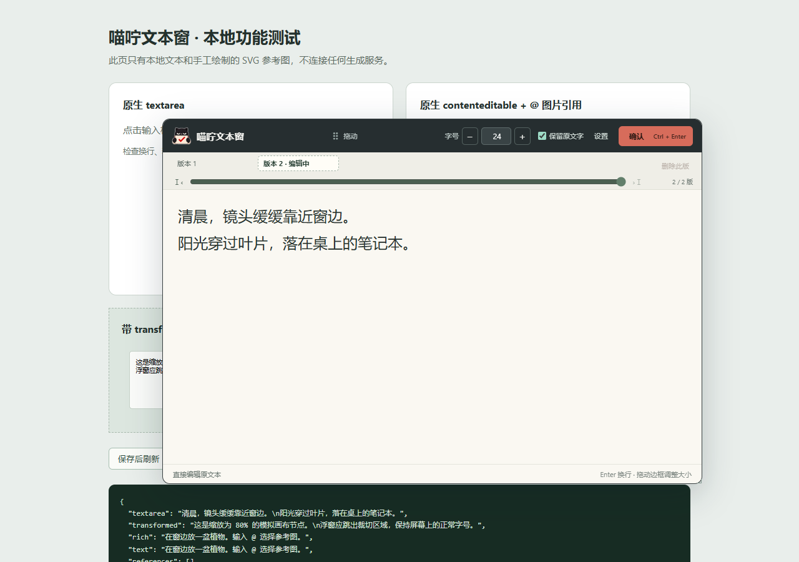

# Miorning Text Float · 喵咛文本窗

A draggable, resizable editor for small web text fields, with local version history and native LibTV image references.

UI is currently Chinese; documentation is available in Chinese and English.

[简体中文](README.md) · [Download v0.2.0](https://github.com/miorning/miorning-text-float/releases/tag/v0.2.0) · [Bilibili](https://space.bilibili.com/353186187)

## Features

- Click a text field to expand it. Move the window, resize any edge or corner, and adjust font size.
- Remember window position, size, font size, and the “keep original text” option.
- Save the initial text and editing drafts. Editing an older version creates a new version and preserves the original. Delete versions or browse with scrolling and a slider.
- Use LibTV’s native `@` references. An exact image name shows a gray suggestion; only `Tab` inserts the reference. Replace the name by default, or choose to keep it.
- Add websites in Settings. Other sites use a generic text-field adapter; proprietary image references need separate integration.

## Install

1. Download and extract `MiorningTextFloat-v0.2.0.zip` from the release.
2. Enable Developer mode on Chrome / Edge’s extensions page.
3. Choose **Load unpacked** and select the package’s **extension** folder.
4. Refresh LibTV and click a prompt field. For another site: **Settings → Add website → Grant permission → Refresh**.

To update, replace the files in the existing installation folder, reload the extension, then refresh the page. Uninstalling deletes local history; avoid uninstalling to update important records.

## Controls and versions

`Enter`: newline · `Ctrl + Enter`: confirm and close (`Cmd + Enter` also works on macOS) · `Alt + Shift + E`: enable / pause.

The first opening saves version 1; editing creates a new version. Drafts save automatically and confirmation commits them. Viewing an older version updates the original field; editing it forks another version. There is no artificial version-count limit, but device storage is finite.

History stays in the current browser profile, separated by website and identifiable field. Anonymous dynamic fields may not retain their identity after refresh. Confirming text does not start image or video generation.

## Compatibility and data

Chrome / Edge 120+. LibTV is enabled by default. Browser internal pages, closed shadow roots, cross-origin iframes, canvas-only inputs, and some complex editors are not guaranteed to work.

No telemetry, text upload, or generation API. The original website may still save edits through its own behavior. See [Privacy](docs/PRIVACY.md) and [Validation](docs/VALIDATION.md).

50 browser checks, 19 storage checks, and 14 website-setting checks passed. Full installed-extension testing on signed-in LibTV, real OS Chinese IME behavior, and first-time permission prompts still need manual verification.

## License

Code is licensed under [GPL-3.0-or-later](LICENSE). Distributing modified derivatives requires GPL compliance and corresponding source for recipients. Private use or modification does not require public release; this does not require publishing your entered text.

[Development](SOURCE.md) · [Release notes](RELEASE-NOTES.md) · [Assets and dependencies](THIRD_PARTY_NOTICES.md) · [Notice](NOTICE.md)
